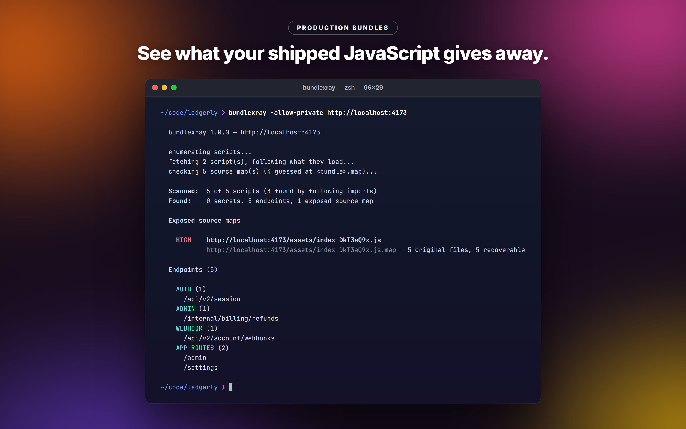
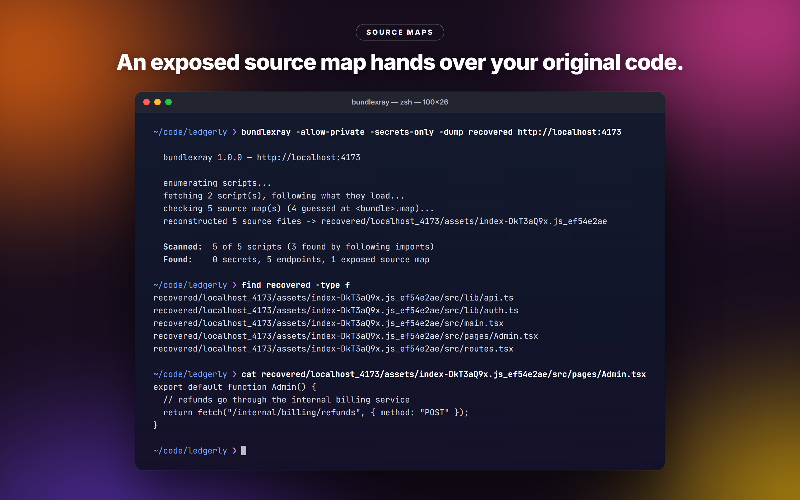
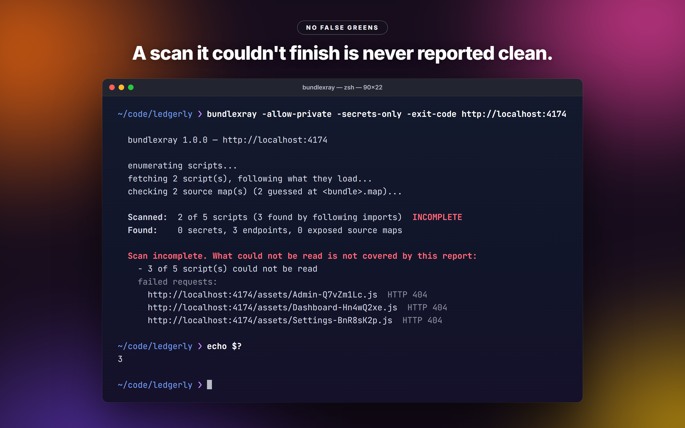

# bundlexray

See what your shipped JavaScript gives away: leaked secrets, the API endpoints your front end calls, and source maps that hand over your original code.



Build tools bundle every API path into the front end, and plenty of teams ship their source maps to production too, which leaves the original, unminified source one `.map` file away from anyone who looks. bundlexray fetches a site's public JavaScript, follows everything it loads, and reports what is exposed. With `--dump` it rebuilds the original source tree from the maps, so you can read your own leak the way an attacker would.

It is one Go binary. It only fetches public assets and reports them; it never tries a key or calls an endpoint it finds.

> Only run it against sites you own or are explicitly authorized to test.

## Install

```bash
go install github.com/NotChaosuu/bundlexray/cmd/bundlexray@latest
```

Go 1.26 or newer. Prebuilt binaries for Linux, macOS and Windows are on the [releases page](https://github.com/NotChaosuu/bundlexray/releases).

## Quick start

```bash
bundlexray https://your-app.example.com                  # secrets, endpoints, exposed source maps
bundlexray https://your-app.example.com --dump ./out     # also rebuild exposed source into ./out
bundlexray https://your-app.example.com --json | jq      # machine-readable report
bundlexray https://your-app.example.com --exit-code      # fail CI on findings or an incomplete scan
```

Flags work before or after the URL.

## Example

A Vite app with its source map left in production, served locally:

```
$ bundlexray -allow-private http://localhost:4173

  bundlexray 1.0.0 — http://localhost:4173

  enumerating scripts...
  fetching 2 script(s), following what they load...
  checking 5 source map(s) (4 guessed at <bundle>.map)...

  Scanned:  5 of 5 scripts (3 found by following imports)
  Found:    0 secrets, 5 endpoints, 1 exposed source map

  Exposed source maps

    HIGH    http://localhost:4173/assets/index-DkT3aQ9x.js
            http://localhost:4173/assets/index-DkT3aQ9x.js.map — 5 original files, 5 recoverable

  Endpoints (5)

    AUTH (1)
      /api/v2/session
    ADMIN (1)
      /internal/billing/refunds
    WEBHOOK (1)
      /api/v2/account/webhooks
    APP ROUTES (2)
      /admin
      /settings
```

`--dump` writes those five files out:



And when it cannot read everything, it says so instead of printing a clean result:



## What it finds

**Secrets.** Prefix-anchored rules for AWS, GitHub, GitLab, npm, Slack, Discord, SendGrid, Mailgun, Stripe, Mapbox, OpenAI, Anthropic, Supabase, Hugging Face, Shopify, Telegram, Twilio, Google OAuth client secrets, Azure storage keys, DigitalOcean, Postman, Braintree, Sentry, database URLs with a password, private keys and JWTs (decoded, so a Supabase `service_role` key is told apart from the public `anon` key). On top of that, any `name = "value"` whose name says credential (`JWT_SECRET_PROD`, `DB_PASSWORD_REPLICA`, `GITHUBTOKEN`, `"Secret Key"`, `Authorization: Bearer ...`) and whose value looks real. Keys split with `+`, written with `\x`/`\u` escapes or wrapped in `atob(...)` are found too, in every script, in the page HTML and in the original sources inside exposed maps.

| Severity | Meaning |
|---|---|
| high | A server-side credential. Rotate it. |
| medium | A value named as a secret or password, or an environment variable a build inlined. |
| low | Often a client key, a test key, a weak password or a plain passphrase. Worth a look. |
| info | Public by design (Google API keys, Stripe publishable keys, analytics keys). Hidden unless `-v`, always in `--json`. |

Values are redacted in the terminal and complete in `--json`.

**Endpoints.** Every path and URL the code holds, grouped by whole path segment (auth, admin, payment, upload, webhook, graphql, websocket, api) and by how the code uses it: a path from a router table or a link is listed under APP ROUTES, apart from the requests the app makes. Assets and template fragments are left out.

**Source maps.** The `SourceMap` header, the `sourceMappingURL` comment, inline `data:` maps and, for same-site bundles that name no map, `<bundle>.map` (where webpack's `hidden-source-map` puts it).

## Flags

| Flag | What it does |
|---|---|
| `--dump DIR` | Rebuild exposed source maps into DIR. |
| `--json` | JSON report on stdout. |
| `--exit-code` | CI gate; see exit codes below. |
| `--allow-incomplete` | With `--exit-code`, do not fail on an incomplete scan. |
| `--allow-unreadable-maps` | With `--exit-code`, do not fail when the only gap is maps the host refused. |
| `--secrets-only`, `--endpoints-only` | Report one kind of finding. |
| `--min-severity LEVEL` | Only report secrets at or above high, medium, low or info. |
| `-v`, `-q` | Show everything, or no banner and progress. |
| `--same-site` | Only fetch from the target's registrable domain. |
| `--allow-host HOST` | Extra host allowed with `--same-site` (repeatable). |
| `--allow-private` | Allow loopback and private addresses (the target's own address is always allowed). |
| `--max-scripts N` | Most scripts to fetch, default 400. |
| `--max-time D` | Time limit for the whole scan, default 10m. |
| `--timeout D` | Per-request timeout, default 15s. |
| `--concurrency N` | Parallel fetches, 1 to 64, default 6. |
| `--user-agent UA` | Send this User-Agent and never retry as a browser. |
| `--no-guess-maps` | Do not probe `<bundle>.map`. |
| `--insecure` | Skip TLS certificate checks. |
| `--version` | Print the version. |

## Exit codes

| Code | Meaning |
|---|---|
| 0 | The scan ran (and, with `--exit-code`, nothing tripped the gate). |
| 1 | With `--exit-code`: a high or medium secret, or a source map with recoverable code. |
| 2 | Usage error, or the page itself could not be fetched. |
| 3 | With `--exit-code`: the scan was incomplete. |

## In CI

```yaml
- name: Check the deployed bundle
  run: |
    go install github.com/NotChaosuu/bundlexray/cmd/bundlexray@latest
    bundlexray https://staging.your-app.example.com --exit-code --same-site
```

## A clean report means everything was read

bundlexray only prints a clean result when it read every script it found. Anything it could not read makes the scan incomplete, with the reason: a script that failed or was not JavaScript (an error page, a challenge, an image), a script outside `--same-site` or the private-address guard, a page that is a bot challenge, the script or time limit, a chunk loader it recognised but could not work out, a truncated download, or a source map it could not check.

To find what a page loads it follows static and dynamic imports (through the page's import map), workers, Vite and Next.js chunk lists, React Router and Remix route manifests, VitePress, Astro islands, Qwik handlers, Parcel, SystemJS, module federation and webpack-style chunk loaders, which it evaluates for every chunk id they name. A chunk name it had to guess and that does not exist is listed apart ("1 guessed chunk not found") and does not count as a gap.

Requests send `Mozilla/5.0 (compatible; bundlexray/1.0; +https://github.com/NotChaosuu/bundlexray)`. A script, map or page that answers 403 or 404, and a page that looks like a crawler version, is fetched once more as Chrome, with a warning when that changed what was scanned. `--user-agent` turns this off. Loopback and private addresses are refused unless the target is itself one.

## Known limitations

- It reports; it does not check whether a key is live. A HIGH is a lead to rotate.
- It reads code, it does not run it. A chunk name built from a run-time value (`window.__CHUNK_MANIFEST__[e]`, a computed `import("./pages/"+name+".js")`) cannot be listed; a loader like that makes the scan incomplete, a plain computed URL is counted in a warning.
- S3 and CloudFront answer 403 for a file that does not exist, so a wrong guess there shows as a gap rather than being dismissed.
- Large single-page apps can pass 400 scripts or 10 minutes. Raise `--max-scripts` and `--max-time`, or use `--allow-incomplete`.
- Some bot protection judges the TLS handshake rather than the user agent and refuses Go's client whatever it sends; the scan then exits 2. A vendor's new interstitial that has none of the known markers is scanned as if it were the site.
- Values are read between plain quotes. A password containing a quote, `<` or a backtick, or one shaped like code (`&&`, `%s`) or a regular expression, is skipped.
- A response compressed with Brotli or zstd that the server sent without being asked is reported as unreadable.
- Original source comes from a map's `sourcesContent`; a map with only `sources` URLs gives the file list, not the code.
- A clean report means nothing leaked on these axes, not that the app is secure.

## License

MIT. See [LICENSE](LICENSE).

## Author

Chaosuu. t.me/chaosuudev. More tools at github.com/NotChaosuu.
